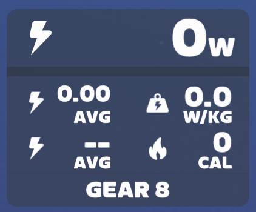
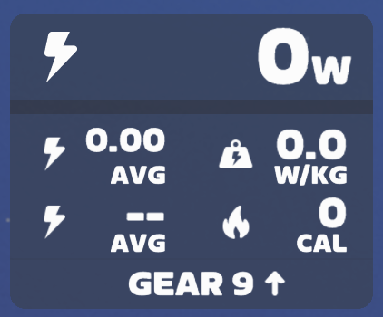
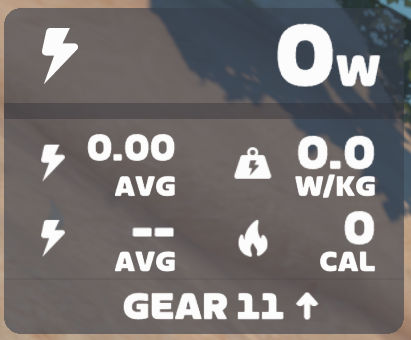
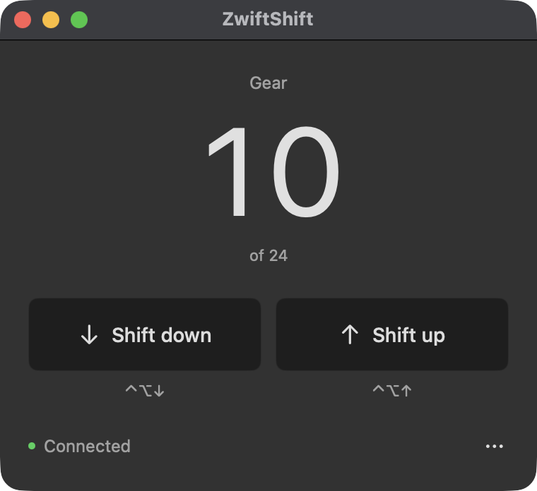
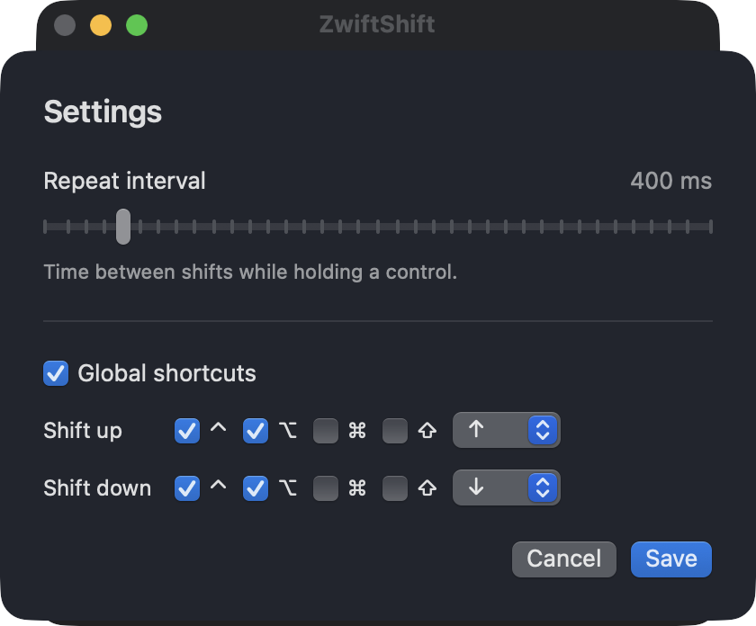

UI made by <b>Claude</b>repo made by <b>me</b>

No Click, no Bluetooth, no dylib, no debugger. My Mac pretends to be a LAN shifting controller, and Zwift moves the real gear.

<b>target</b>Zwift 1.125.0 (168455)

<b>transport</b>DirCon · Bonjour + TCP

<b>proof</b>Zwift's Log.txt + HUD

<b>result</b>12/12 live cases

## play with it

<iframe src="../media/post12/shifter3d.html?v=1" title="Interactive 3D drivetrain: Mac, DirCon cable, derailleur, 24-cog virtual cassette, live readout" loading="lazy"></iframe>

3D · drag to orbit · ↑ ↓ or the buttons · chain, cassette and jockeys turn together, the readout is the real payload, button map and Log.txt line

## life of one upshift

<iframe src="../media/post12/pipeline3d.html?v=1" title="3D pipeline: input, ShiftService, ButtonPulse, DirCon socket, Zwift, cassette and Log.txt, with a packet travelling through" loading="lazy"></iframe>

3D · drag to orbit · blue packet goes out over DirCon, green confirmation comes back from Log.txt

## the frame, exploded

<iframe src="../media/post12/frame3d.html?v=2" title="3D exploded view of the 29-byte DirCon notify frame, six layers that assemble and explode" loading="lazy"></iframe>

3D · drag to orbit · real bytes on every layer · 6 + 16 + 1 + 6 = 29

## dead ends

<svg class="p12-d" viewBox="0 0 840 316" font-family="IBM Plex Mono, ui-monospace, monospace" role="img" aria-label="Four input routes and how far each got before failing; only the LAN exercise device route moves the real gear"><defs><marker id="ak" viewBox="0 0 10 10" refX="9" refY="5" markerWidth="7" markerHeight="7" orient="auto-start-reverse"><path d="M0 0 L10 5 L0 10 z" fill="#1a1a1a"/></marker><marker id="ab" viewBox="0 0 10 10" refX="9" refY="5" markerWidth="7" markerHeight="7" orient="auto-start-reverse"><path d="M0 0 L10 5 L0 10 z" fill="#1d4ed8"/></marker><marker id="ag" viewBox="0 0 10 10" refX="9" refY="5" markerWidth="7" markerHeight="7" orient="auto-start-reverse"><path d="M0 0 L10 5 L0 10 z" fill="#15803d"/></marker><marker id="ar" viewBox="0 0 10 10" refX="9" refY="5" markerWidth="7" markerHeight="7" orient="auto-start-reverse"><path d="M0 0 L10 5 L0 10 z" fill="#b91c1c"/></marker><marker id="am" viewBox="0 0 10 10" refX="9" refY="5" markerWidth="7" markerHeight="7" orient="auto-start-reverse"><path d="M0 0 L10 5 L0 10 z" fill="#8a8a88"/></marker><marker id="aa" viewBox="0 0 10 10" refX="9" refY="5" markerWidth="7" markerHeight="7" orient="auto-start-reverse"><path d="M0 0 L10 5 L0 10 z" fill="#b45309"/></marker><pattern id="hatch" width="6" height="6" patternUnits="userSpaceOnUse" patternTransform="rotate(45)"><line x1="0" y1="0" x2="0" y2="6" stroke="#b91c1c" stroke-width="1.4" opacity="0.35"/></pattern></defs><text x="330" y="22" font-size="10.5" fill="#1a1a1a" font-weight="600" text-anchor="middle" >OS accepts it</text><text x="330" y="36" font-size="9" fill="#8a8a88" font-weight="400" text-anchor="middle" >level 2 · platform</text><line x1="330" y1="46" x2="330" y2="300" stroke="#d8d8d6" stroke-width="1" stroke-dasharray="2 4" /><text x="500" y="22" font-size="10.5" fill="#1a1a1a" font-weight="600" text-anchor="middle" >Zwift receives it</text><text x="500" y="36" font-size="9" fill="#8a8a88" font-weight="400" text-anchor="middle" >level 3 · discovery</text><line x1="500" y1="46" x2="500" y2="300" stroke="#d8d8d6" stroke-width="1" stroke-dasharray="2 4" /><text x="670" y="22" font-size="10.5" fill="#1a1a1a" font-weight="600" text-anchor="middle" >real gear moves</text><text x="670" y="36" font-size="9" fill="#8a8a88" font-weight="400" text-anchor="middle" >level 4 · effect</text><line x1="670" y1="46" x2="670" y2="300" stroke="#d8d8d6" stroke-width="1" stroke-dasharray="2 4" /><text x="14" y="22" font-size="10.5" fill="#1a1a1a" font-weight="600" text-anchor="start" >route</text><text x="14" y="36" font-size="9" fill="#8a8a88" font-weight="400" text-anchor="start" >how far it got</text><text x="14" y="79" font-size="11" fill="#1a1a1a" font-weight="600" text-anchor="start" >virtual HID gamepad</text><text x="14" y="93" font-size="9" fill="#8a8a88" font-weight="400" text-anchor="start" >IOHIDManager + controller db</text><line x1="236" y1="82" x2="790" y2="82" stroke="#d8d8d6" stroke-width="2" /><line x1="236" y1="82" x2="316" y2="82" stroke="#1a1a1a" stroke-width="3" stroke-linecap="round"/><circle cx="236" cy="82" r="5" fill="#1a1a1a"/><rect x="324" y="67" width="12" height="30" fill="url(#hatch)" stroke="#b91c1c" stroke-width="1.4" rx="0" /><path d="M326 78 l8 8 M334 78 l-8 8" stroke="#b91c1c" stroke-width="2" stroke-linecap="round"/><text x="346" y="74" font-size="10" fill="#b91c1c" font-weight="600" text-anchor="start" >IOHIDUserDeviceCreate → NULL</text><text x="346" y="99" font-size="9" fill="#8a8a88" font-weight="400" text-anchor="start" >no device ever exists</text><circle cx="500" cy="82" r="4" fill="#fff" stroke="#d8d8d6" stroke-width="1.5"/><circle cx="670" cy="82" r="4" fill="#fff" stroke="#d8d8d6" stroke-width="1.5"/><text x="14" y="137" font-size="11" fill="#1a1a1a" font-weight="600" text-anchor="start" >same-Mac BLE peripheral</text><text x="14" y="151" font-size="9" fill="#8a8a88" font-weight="400" text-anchor="start" >CoreBluetooth, FC82 ad</text><line x1="236" y1="140" x2="790" y2="140" stroke="#d8d8d6" stroke-width="2" /><line x1="236" y1="140" x2="486" y2="140" stroke="#1a1a1a" stroke-width="3" stroke-linecap="round"/><circle cx="236" cy="140" r="5" fill="#1a1a1a"/><circle cx="330" cy="140" r="8" fill="#fff" stroke="#15803d" stroke-width="2"/><path d="M326.5 140 l2.5 2.6 l4.8 -5.2" fill="none" stroke="#15803d" stroke-width="2" stroke-linecap="round"/><rect x="494" y="125" width="12" height="30" fill="url(#hatch)" stroke="#b91c1c" stroke-width="1.4" rx="0" /><path d="M496 136 l8 8 M504 136 l-8 8" stroke="#b91c1c" stroke-width="2" stroke-linecap="round"/><text x="516" y="132" font-size="10" fill="#b91c1c" font-weight="600" text-anchor="start" >own ad never seen</text><text x="516" y="157" font-size="9" fill="#8a8a88" font-weight="400" text-anchor="start" >20 s scan · found the KICKR · 0 subs</text><circle cx="670" cy="140" r="4" fill="#fff" stroke="#d8d8d6" stroke-width="1.5"/><text x="14" y="195" font-size="11" fill="#1a1a1a" font-weight="600" text-anchor="start" >synthetic keys + mouse</text><text x="14" y="209" font-size="9" fill="#8a8a88" font-weight="400" text-anchor="start" >CGEvent → Cocoa → GLFW</text><line x1="236" y1="198" x2="790" y2="198" stroke="#d8d8d6" stroke-width="2" /><line x1="236" y1="198" x2="656" y2="198" stroke="#1a1a1a" stroke-width="3" stroke-linecap="round"/><circle cx="236" cy="198" r="5" fill="#1a1a1a"/><circle cx="330" cy="198" r="8" fill="#fff" stroke="#15803d" stroke-width="2"/><path d="M326.5 198 l2.5 2.6 l4.8 -5.2" fill="none" stroke="#15803d" stroke-width="2" stroke-linecap="round"/><circle cx="500" cy="198" r="8" fill="#fff" stroke="#15803d" stroke-width="2"/><path d="M496.5 198 l2.5 2.6 l4.8 -5.2" fill="none" stroke="#15803d" stroke-width="2" stroke-linecap="round"/><rect x="664" y="183" width="12" height="30" fill="url(#hatch)" stroke="#b91c1c" stroke-width="1.4" rx="0" /><path d="M666 194 l8 8 M674 194 l-8 8" stroke="#b91c1c" stroke-width="2" stroke-linecap="round"/><text x="686" y="190" font-size="10" fill="#b91c1c" font-weight="600" text-anchor="start" >no gear key binding</text><text x="686" y="215" font-size="9" fill="#8a8a88" font-weight="400" text-anchor="start" >SHIFTUP is just a string</text><rect x="6" y="230" width="828" height="52" fill="#f4faf6" stroke="#cfe7d7" stroke-width="1" rx="0" /><text x="14" y="253" font-size="11" fill="#1a1a1a" font-weight="600" text-anchor="start" >LAN exercise device</text><text x="14" y="267" font-size="9" fill="#8a8a88" font-weight="400" text-anchor="start" >DirCon · _wahoo-fitness-tnp._tcp</text><line x1="236" y1="256" x2="790" y2="256" stroke="#d8d8d6" stroke-width="2" /><line x1="236" y1="256" x2="768" y2="256" stroke="#15803d" stroke-width="3" stroke-linecap="round" marker-end="url(#ag)"/><circle cx="236" cy="256" r="5" fill="#1a1a1a"/><circle cx="330" cy="256" r="8" fill="#fff" stroke="#15803d" stroke-width="2"/><path d="M326.5 256 l2.5 2.6 l4.8 -5.2" fill="none" stroke="#15803d" stroke-width="2" stroke-linecap="round"/><circle cx="500" cy="256" r="8" fill="#fff" stroke="#15803d" stroke-width="2"/><path d="M496.5 256 l2.5 2.6 l4.8 -5.2" fill="none" stroke="#15803d" stroke-width="2" stroke-linecap="round"/><circle cx="670" cy="256" r="8" fill="#fff" stroke="#15803d" stroke-width="2"/><path d="M666.5 256 l2.5 2.6 l4.8 -5.2" fill="none" stroke="#15803d" stroke-width="2" stroke-linecap="round"/><circle cx="330" cy="256" r="8" fill="#fff" stroke="#15803d" stroke-width="2"/><path d="M326.5 256 l2.5 2.6 l4.8 -5.2" fill="none" stroke="#15803d" stroke-width="2" stroke-linecap="round"/><circle cx="500" cy="256" r="8" fill="#fff" stroke="#15803d" stroke-width="2"/><path d="M496.5 256 l2.5 2.6 l4.8 -5.2" fill="none" stroke="#15803d" stroke-width="2" stroke-linecap="round"/><circle cx="670" cy="256" r="8" fill="#fff" stroke="#15803d" stroke-width="2"/><path d="M666.5 256 l2.5 2.6 l4.8 -5.2" fill="none" stroke="#15803d" stroke-width="2" stroke-linecap="round"/><rect x="792" y="243" width="40" height="26" fill="#15803d" stroke="#15803d" stroke-width="1" rx="2" /><text x="812" y="260" font-size="9" fill="#fff" font-weight="600" text-anchor="middle" >GEAR</text><text x="670" y="276" font-size="9.5" fill="#15803d" font-weight="600" text-anchor="middle" >Gearing: Shift 0-(8 -&gt; 9)</text></svg>

## pairing

<svg class="p12-d" viewBox="0 0 840 446" font-family="IBM Plex Mono, ui-monospace, monospace" role="img" aria-label="Pairing state machine: three advertised service sets and where each one ends up, plus the device-name cache and the final role table"><defs><marker id="ak" viewBox="0 0 10 10" refX="9" refY="5" markerWidth="7" markerHeight="7" orient="auto-start-reverse"><path d="M0 0 L10 5 L0 10 z" fill="#1a1a1a"/></marker><marker id="ab" viewBox="0 0 10 10" refX="9" refY="5" markerWidth="7" markerHeight="7" orient="auto-start-reverse"><path d="M0 0 L10 5 L0 10 z" fill="#1d4ed8"/></marker><marker id="ag" viewBox="0 0 10 10" refX="9" refY="5" markerWidth="7" markerHeight="7" orient="auto-start-reverse"><path d="M0 0 L10 5 L0 10 z" fill="#15803d"/></marker><marker id="ar" viewBox="0 0 10 10" refX="9" refY="5" markerWidth="7" markerHeight="7" orient="auto-start-reverse"><path d="M0 0 L10 5 L0 10 z" fill="#b91c1c"/></marker><marker id="am" viewBox="0 0 10 10" refX="9" refY="5" markerWidth="7" markerHeight="7" orient="auto-start-reverse"><path d="M0 0 L10 5 L0 10 z" fill="#8a8a88"/></marker><marker id="aa" viewBox="0 0 10 10" refX="9" refY="5" markerWidth="7" markerHeight="7" orient="auto-start-reverse"><path d="M0 0 L10 5 L0 10 z" fill="#b45309"/></marker><pattern id="hatch" width="6" height="6" patternUnits="userSpaceOnUse" patternTransform="rotate(45)"><line x1="0" y1="0" x2="0" y2="6" stroke="#b91c1c" stroke-width="1.4" opacity="0.35"/></pattern></defs><rect x="8" y="138" width="118" height="50" fill="#fff" stroke="#1a1a1a" stroke-width="1" rx="0" /><text x="18" y="159.5" font-size="10.5" fill="#1a1a1a" font-weight="600" text-anchor="start" >Bonjour ad</text><text x="18" y="173.5" font-size="10" fill="#8a8a88" font-weight="400" text-anchor="start" >mDNS · DirCon</text><rect x="150" y="138" width="108" height="50" fill="#fff" stroke="#1a1a1a" stroke-width="1" rx="0" /><text x="160" y="159.5" font-size="10.5" fill="#1a1a1a" font-weight="600" text-anchor="start" >discovered</text><text x="160" y="173.5" font-size="10" fill="#8a8a88" font-weight="400" text-anchor="start" >Zwift log line</text><path d="M126 163 C137.0 163, 137.0 163, 148 163" fill="none" stroke="#8a8a88" stroke-width="1.4" marker-end="url(#am)"/><path d="M258 163 C274.0 163, 274.0 65, 290 65" fill="none" stroke="#b91c1c" stroke-width="1.4" marker-end="url(#ar)"/><rect x="292" y="40" width="132" height="50" fill="#fff" stroke="#b91c1c" stroke-width="1" rx="0" /><text x="302" y="61.5" font-size="10.5" fill="#b91c1c" font-weight="600" text-anchor="start" >fc82</text><text x="302" y="75.5" font-size="10" fill="#8a8a88" font-weight="400" text-anchor="start" >Zwift Protocol</text><path d="M424 65 C438.0 65, 438.0 65, 452 65" fill="none" stroke="#b91c1c" stroke-width="1.4" marker-end="url(#ar)"/><rect x="454" y="40" width="146" height="50" fill="#fff" stroke="#1a1a1a" stroke-width="1" rx="0" /><text x="464" y="61.5" font-size="10.5" fill="#1a1a1a" font-weight="600" text-anchor="start" >no role service</text><text x="464" y="75.5" font-size="10" fill="#8a8a88" font-weight="400" text-anchor="start" >not in any picker</text><path d="M600 65 C614.0 65, 614.0 65, 628 65" fill="none" stroke="#b91c1c" stroke-width="1.4" marker-end="url(#ar)"/><rect x="630" y="40" width="202" height="50" fill="#fdf3f3" stroke="#b91c1c" stroke-width="1.6" rx="0" /><text x="640" y="61.5" font-size="10.5" fill="#b91c1c" font-weight="600" text-anchor="start" >✗ never selectable</text><text x="640" y="75.5" font-size="10" fill="#8a8a88" font-weight="400" text-anchor="start" >discovery ≠ classification</text><path d="M258 163 C274.0 163, 274.0 163, 290 163" fill="none" stroke="#b45309" stroke-width="1.4" marker-end="url(#aa)"/><rect x="292" y="138" width="132" height="50" fill="#fff" stroke="#b45309" stroke-width="1" rx="0" /><text x="302" y="159.5" font-size="10.5" fill="#b45309" font-weight="600" text-anchor="start" >fc82 + 1818</text><text x="302" y="173.5" font-size="10" fill="#8a8a88" font-weight="400" text-anchor="start" >+ Cycling Power</text><path d="M424 163 C438.0 163, 438.0 163, 452 163" fill="none" stroke="#b45309" stroke-width="1.4" marker-end="url(#aa)"/><rect x="454" y="138" width="146" height="50" fill="#fff" stroke="#1a1a1a" stroke-width="1" rx="0" /><text x="464" y="159.5" font-size="10.5" fill="#1a1a1a" font-weight="600" text-anchor="start" >Power Source</text><text x="464" y="173.5" font-size="10" fill="#8a8a88" font-weight="400" text-anchor="start" >picker lists it</text><path d="M600 163 C614.0 163, 614.0 163, 628 163" fill="none" stroke="#b45309" stroke-width="1.4" marker-end="url(#aa)"/><rect x="630" y="138" width="202" height="50" fill="#fff8ec" stroke="#b45309" stroke-width="1.6" rx="0" /><text x="640" y="159.5" font-size="10.5" fill="#b45309" font-weight="600" text-anchor="start" >⚠ 0 W ride</text><text x="640" y="173.5" font-size="10" fill="#8a8a88" font-weight="400" text-anchor="start" >power meter, no power</text><path d="M258 163 C274.0 163, 274.0 261, 290 261" fill="none" stroke="#15803d" stroke-width="1.4" marker-end="url(#ag)"/><rect x="292" y="236" width="132" height="50" fill="#fff" stroke="#15803d" stroke-width="1" rx="0" /><text x="302" y="257.5" font-size="10.5" fill="#15803d" font-weight="600" text-anchor="start" >fc82 + 180d</text><text x="302" y="271.5" font-size="10" fill="#8a8a88" font-weight="400" text-anchor="start" >+ Heart Rate</text><path d="M424 261 C438.0 261, 438.0 261, 452 261" fill="none" stroke="#15803d" stroke-width="1.4" marker-end="url(#ag)"/><rect x="454" y="236" width="146" height="50" fill="#fff" stroke="#1a1a1a" stroke-width="1" rx="0" /><text x="464" y="257.5" font-size="10.5" fill="#1a1a1a" font-weight="600" text-anchor="start" >HR picker → TCP</text><text x="464" y="271.5" font-size="10" fill="#8a8a88" font-weight="400" text-anchor="start" >DevInfo read</text><path d="M600 261 C614.0 261, 614.0 261, 628 261" fill="none" stroke="#15803d" stroke-width="1.4" marker-end="url(#ag)"/><rect x="630" y="236" width="202" height="50" fill="#f4faf6" stroke="#15803d" stroke-width="1.6" rx="0" /><text x="640" y="257.5" font-size="10.5" fill="#15803d" font-weight="600" text-anchor="start" >✓ component 23</text><text x="640" y="271.5" font-size="10" fill="#8a8a88" font-weight="400" text-anchor="start" >listed in Controls</text><text x="630" y="300" font-size="9" fill="#8a8a88" font-weight="400" text-anchor="start" >0 bpm on HR: least harmful trap</text><line x1="8" y1="324" x2="832" y2="324" stroke="#d8d8d6" stroke-width="1" /><text x="8" y="346" font-size="10.5" fill="#1a1a1a" font-weight="600" text-anchor="start" >known-device cache · keyed by NAME</text><rect x="8" y="358" width="196" height="50" fill="#fdf3f3" stroke="#b91c1c" stroke-width="1" rx="0" /><text x="18" y="379.5" font-size="10.5" fill="#b91c1c" font-weight="600" text-anchor="start" >"ZwiftShift Input"</text><text x="18" y="393.5" font-size="10" fill="#8a8a88" font-weight="400" text-anchor="start" >class: power (stale)</text><path d="M204 383 C225.0 383, 225.0 383, 246 383" fill="none" stroke="#1a1a1a" stroke-width="1.4" marker-end="url(#ak)"/><text x="225" y="374" font-size="9" fill="#8a8a88" font-weight="400" text-anchor="middle" >rename</text><rect x="248" y="358" width="196" height="50" fill="#f4faf6" stroke="#15803d" stroke-width="1" rx="0" /><text x="258" y="379.5" font-size="10.5" fill="#15803d" font-weight="600" text-anchor="start" >"ZwiftShift"</text><text x="258" y="393.5" font-size="10" fill="#8a8a88" font-weight="400" text-anchor="start" >serial 100000004 · fresh</text><text x="248" y="424" font-size="9" fill="#8a8a88" font-weight="400" text-anchor="start" >MAC 02:5A:53:48:49:49</text><rect x="470" y="336" width="362" height="112" fill="#111" stroke="#111" stroke-width="1" rx="0" /><text x="482" y="354" font-size="9.5" fill="#9a9a98" font-weight="600" text-anchor="start" >PAIRED DEVICES</text><text x="482" y="372.0" font-size="10" fill="#cfcfcd" font-weight="400" text-anchor="start" >Power Source</text><text x="820" y="372.0" font-size="10" fill="#ffffff" font-weight="400" text-anchor="end" >KICKR CORE CED4</text><text x="482" y="387.5" font-size="10" fill="#cfcfcd" font-weight="400" text-anchor="start" >Resistance</text><text x="820" y="387.5" font-size="10" fill="#ffffff" font-weight="400" text-anchor="end" >KICKR CORE CED4</text><text x="482" y="403.0" font-size="10" fill="#cfcfcd" font-weight="400" text-anchor="start" >Cadence</text><text x="820" y="403.0" font-size="10" fill="#ffffff" font-weight="400" text-anchor="end" >KICKR CORE CED4</text><text x="482" y="418.5" font-size="10" fill="#cfcfcd" font-weight="400" text-anchor="start" >Heart Rate</text><text x="820" y="418.5" font-size="10" fill="#ffffff" font-weight="400" text-anchor="end" >KICKR CORE CED4</text><text x="482" y="434.0" font-size="10" fill="#cfcfcd" font-weight="400" text-anchor="start" >Controls</text><text x="820" y="434.0" font-size="10" fill="#93b4ff" font-weight="600" text-anchor="end" >ZwiftShift</text><circle cx="734" cy="430.5" r="3" fill="#22c55e"/></svg>

Zwift caches classification by device name, so the old name stayed a "power meter" after the service swap.

## handshake

<svg class="p12-d" viewBox="0 0 840 784" font-family="IBM Plex Mono, ui-monospace, monospace" role="img" aria-label="Sequence diagram of the DirCon handshake between Zwift and ZwiftShift with exact bytes for every message"><defs><marker id="ak" viewBox="0 0 10 10" refX="9" refY="5" markerWidth="7" markerHeight="7" orient="auto-start-reverse"><path d="M0 0 L10 5 L0 10 z" fill="#1a1a1a"/></marker><marker id="ab" viewBox="0 0 10 10" refX="9" refY="5" markerWidth="7" markerHeight="7" orient="auto-start-reverse"><path d="M0 0 L10 5 L0 10 z" fill="#1d4ed8"/></marker><marker id="ag" viewBox="0 0 10 10" refX="9" refY="5" markerWidth="7" markerHeight="7" orient="auto-start-reverse"><path d="M0 0 L10 5 L0 10 z" fill="#15803d"/></marker><marker id="ar" viewBox="0 0 10 10" refX="9" refY="5" markerWidth="7" markerHeight="7" orient="auto-start-reverse"><path d="M0 0 L10 5 L0 10 z" fill="#b91c1c"/></marker><marker id="am" viewBox="0 0 10 10" refX="9" refY="5" markerWidth="7" markerHeight="7" orient="auto-start-reverse"><path d="M0 0 L10 5 L0 10 z" fill="#8a8a88"/></marker><marker id="aa" viewBox="0 0 10 10" refX="9" refY="5" markerWidth="7" markerHeight="7" orient="auto-start-reverse"><path d="M0 0 L10 5 L0 10 z" fill="#b45309"/></marker><pattern id="hatch" width="6" height="6" patternUnits="userSpaceOnUse" patternTransform="rotate(45)"><line x1="0" y1="0" x2="0" y2="6" stroke="#b91c1c" stroke-width="1.4" opacity="0.35"/></pattern></defs><rect x="76" y="8" width="184" height="40" fill="#1a1a1a" stroke="#1a1a1a" stroke-width="1" rx="0" /><text x="168" y="25" font-size="11" fill="#fff" font-weight="600" text-anchor="middle" >Zwift 1.125.0</text><text x="168" y="39" font-size="9" fill="#9a9a98" font-weight="400" text-anchor="middle" >LanExerciseDevice</text><rect x="602" y="8" width="184" height="40" fill="#fff" stroke="#1a1a1a" stroke-width="1.5" rx="0" /><text x="694" y="25" font-size="11" fill="#1a1a1a" font-weight="600" text-anchor="middle" >ZwiftShift :54872</text><text x="694" y="39" font-size="9" fill="#8a8a88" font-weight="400" text-anchor="middle" >DirConSession</text><line x1="168" y1="52" x2="168" y2="744" stroke="#1a1a1a" stroke-width="1.4" stroke-dasharray="3 3" /><line x1="694" y1="52" x2="694" y2="744" stroke="#1a1a1a" stroke-width="1.4" stroke-dasharray="3 3" /><rect x="164" y="62" width="8" height="674" fill="#e9e9e6" stroke="#1a1a1a" stroke-width="1" rx="0" /><rect x="690" y="62" width="8" height="674" fill="#e8eefc" stroke="#1d4ed8" stroke-width="1" rx="0" /><rect x="10" y="62" width="4" height="204" fill="#1d4ed8" stroke="#1d4ed8" stroke-width="1" rx="0" /><text transform="translate(28 164.0) rotate(-90)" font-size="9.5" fill="#1d4ed8" font-weight="600" text-anchor="middle">discover</text><rect x="10" y="268" width="4" height="84" fill="#7c3aed" stroke="#7c3aed" stroke-width="1" rx="0" /><text transform="translate(28 310.0) rotate(-90)" font-size="9.5" fill="#7c3aed" font-weight="600" text-anchor="middle">handshake</text><rect x="10" y="354" width="4" height="256" fill="#15803d" stroke="#15803d" stroke-width="1" rx="0" /><text transform="translate(28 482.0) rotate(-90)" font-size="9.5" fill="#15803d" font-weight="600" text-anchor="middle">capabilities</text><rect x="10" y="620" width="4" height="112" fill="#15803d" stroke="#15803d" stroke-width="1" rx="0" /><text transform="translate(28 676) rotate(-90)" font-size="9.5" fill="#15803d" font-weight="600" text-anchor="middle">input</text><line x1="174" y1="84" x2="686" y2="84" stroke="#1a1a1a" stroke-width="1.4" marker-end="url(#ak)"/><text x="184" y="78" font-size="10.5" fill="#1a1a1a" font-weight="600" text-anchor="start" >01 services</text><line x1="688" y1="124" x2="176" y2="124" stroke="#1d4ed8" stroke-width="1.4" stroke-dasharray="5 3" marker-end="url(#ab)"/><text x="678" y="118" font-size="10.5" fill="#1d4ed8" font-weight="500" text-anchor="end" >fc82 · 180d · 180a · 180f</text><text x="678" y="138" font-size="9" fill="#8a8a88" font-weight="400" text-anchor="end" >16-byte UUIDs</text><line x1="174" y1="164" x2="686" y2="164" stroke="#1a1a1a" stroke-width="1.4" marker-end="url(#ak)"/><text x="184" y="158" font-size="10.5" fill="#1a1a1a" font-weight="600" text-anchor="start" >02 characteristics(fc82)</text><line x1="688" y1="204" x2="176" y2="204" stroke="#1d4ed8" stroke-width="1.4" stroke-dasharray="5 3" marker-end="url(#ab)"/><text x="678" y="198" font-size="10.5" fill="#1d4ed8" font-weight="500" text-anchor="end" >02 notify · 03 write · 04 notify</text><text x="678" y="218" font-size="9" fill="#8a8a88" font-weight="400" text-anchor="end" >masks 04 · 02 · 04</text><line x1="174" y1="244" x2="686" y2="244" stroke="#1a1a1a" stroke-width="1.4" marker-end="url(#ak)"/><text x="184" y="238" font-size="10.5" fill="#1a1a1a" font-weight="600" text-anchor="start" >05 subscribe 02, 04</text><line x1="174" y1="290" x2="686" y2="290" stroke="#1a1a1a" stroke-width="1.4" marker-end="url(#ak)"/><text x="184" y="284" font-size="10.5" fill="#1a1a1a" font-weight="600" text-anchor="start" >04 write 03 · "RideOn" 02 04</text><text x="184" y="304" font-size="9" fill="#8a8a88" font-weight="400" text-anchor="start" >52 69 64 65 4f 6e 02 04</text><line x1="688" y1="330" x2="176" y2="330" stroke="#1d4ed8" stroke-width="1.4" stroke-dasharray="5 3" marker-end="url(#ab)"/><text x="678" y="324" font-size="10.5" fill="#1d4ed8" font-weight="500" text-anchor="end" >06 notify 04 · "RideOn" 02 00</text><text x="678" y="344" font-size="9" fill="#8a8a88" font-weight="400" text-anchor="end" >52 69 64 65 4f 6e 02 00 · unencrypted</text><line x1="174" y1="376" x2="686" y2="376" stroke="#1a1a1a" stroke-width="1.4" marker-end="url(#ak)"/><text x="184" y="370" font-size="10.5" fill="#1a1a1a" font-weight="600" text-anchor="start" >GET 0x000 DevInfo</text><text x="184" y="390" font-size="9" fill="#8a8a88" font-weight="400" text-anchor="start" >00 08 00</text><line x1="688" y1="416" x2="176" y2="416" stroke="#1d4ed8" stroke-width="1.4" stroke-dasharray="5 3" marker-end="url(#ab)"/><text x="678" y="410" font-size="10.5" fill="#1d4ed8" font-weight="500" text-anchor="end" >DevInfo { field 1: page }</text><text x="678" y="430" font-size="9" fill="#8a8a88" font-weight="400" text-anchor="end" >3c 08 00 12 11 0a 0f 08 80 04 42 04 …</text><rect x="236" y="436" width="380" height="52" fill="#fdf3f3" stroke="#f1c4c4" stroke-width="1" rx="0" /><text x="246" y="452" font-size="9.5" fill="#b91c1c" font-weight="600" text-anchor="start" >raw  3c 08 00 12 0f 08 80 04 …</text><text x="486" y="452" font-size="9.5" fill="#b91c1c" font-weight="400" text-anchor="start" >✗ nanopb wire type</text><text x="246" y="468" font-size="9.5" fill="#15803d" font-weight="600" text-anchor="start" xml:space="preserve">fix  3c 08 00 12 11 </text><text x="368.0" y="468" font-size="9.5" fill="#fff" font-weight="700"><tspan style="paint-order:stroke" stroke="#15803d" stroke-width="9">0a 0f</tspan></text><text x="404.6" y="468" font-size="9.5" fill="#15803d" font-weight="600" text-anchor="start" >08 80 04 …</text><text x="486" y="468" font-size="9.5" fill="#15803d" font-weight="400" text-anchor="start" >✓ +2 B envelope</text><text x="246" y="482" font-size="8.5" fill="#8a8a88" font-weight="400" text-anchor="start" >found by watching the real decoder with a read-only Frida hook</text><line x1="174" y1="514" x2="686" y2="514" stroke="#1a1a1a" stroke-width="1.4" marker-end="url(#ak)"/><text x="184" y="508" font-size="10.5" fill="#1a1a1a" font-weight="600" text-anchor="start" >GET 0x010 · 0x400 · 0x303</text><text x="184" y="528" font-size="9" fill="#8a8a88" font-weight="400" text-anchor="start" >00 08 10 · 00 08 80 08 · 00 08 83 06</text><line x1="688" y1="554" x2="176" y2="554" stroke="#1d4ed8" stroke-width="1.4" stroke-dasharray="5 3" marker-end="url(#ab)"/><text x="678" y="548" font-size="10.5" fill="#1d4ed8" font-weight="500" text-anchor="end" >empty · mask 0x1100 · 0,100,0,0</text><text x="678" y="568" font-size="9" fill="#8a8a88" font-weight="400" text-anchor="end" >3c 08 80 08 12 05 08 80 22 10 00</text><rect x="182" y="580" width="246" height="24" fill="#fff7d6" stroke="#e9d48a" stroke-width="1" rx="0" /><text x="192" y="596" font-size="9.5" fill="#7a5b00" font-weight="400" text-anchor="start" >adds component 23 · role ZP User Input</text><rect x="162" y="620" width="616" height="112" fill="none" stroke="#8a8a88" stroke-width="1" rx="0" stroke-dasharray="4 3"/><rect x="162" y="620" width="118" height="16" fill="#8a8a88" stroke="#8a8a88" stroke-width="1" rx="0" /><text x="170" y="631.5" font-size="9" fill="#fff" font-weight="600" text-anchor="start" >loop · per shift</text><line x1="688" y1="660" x2="176" y2="660" stroke="#15803d" stroke-width="1.6" stroke-dasharray="5 3" marker-end="url(#ag)"/><text x="678" y="654" font-size="10.5" fill="#15803d" font-weight="600" text-anchor="end" >06 notify 02 · press up</text><text x="678" y="674" font-size="9" fill="#8a8a88" font-weight="400" text-anchor="end" >23 08 ff df ff ff 0f · bit 12 low</text><line x1="688" y1="700" x2="176" y2="700" stroke="#1d4ed8" stroke-width="1.6" stroke-dasharray="5 3" marker-end="url(#ab)"/><text x="678" y="694" font-size="10.5" fill="#1d4ed8" font-weight="600" text-anchor="end" >06 notify 02 · neutral</text><text x="678" y="714" font-size="9" fill="#8a8a88" font-weight="400" text-anchor="end" >23 08 ff ff ff ff 0f</text><line x1="710" y1="660" x2="710" y2="700" stroke="#15803d" stroke-width="1.4" /><line x1="706" y1="660" x2="714" y2="660" stroke="#15803d" stroke-width="1.4" /><line x1="706" y1="700" x2="714" y2="700" stroke="#15803d" stroke-width="1.4" /><text x="720" y="684" font-size="9.5" fill="#15803d" font-weight="600" text-anchor="start" >≥120 ms</text><text x="182" y="724" font-size="9.5" fill="#1a1a1a" font-weight="600" text-anchor="start" xml:space="preserve">Gearing: Shift 0-(8 -&gt; 9)  → Log.txt</text><text x="690" y="756" font-size="9" fill="#8a8a88" font-weight="400" text-anchor="end" >neutral keepalive every 4 s, never interrupts a live pulse</text><text x="832" y="774" font-size="9" fill="#8a8a88" font-weight="400" text-anchor="end" >number = DirCon kind · 01 services · 02 chars · 04 write · 05 subscribe · 06 notify</text></svg>

The LAN session is plaintext. The BLE Click does ECDH + HKDF + AES-CCM. An unknown <code>RideOn</code> version throws instead of guessing.

## proof

8 → 9 at 10:33:56, first software shift, no debugger · 11 at home with the real KICKR

<b>10→11→10</b>cli

<b>10→15→10</b>cli ×5

<b>10→11→10</b>mouse tap

<b>10→14→10</b>mouse hold

<b>10→11→10</b>hotkey tap

<b>10→14→10</b>hotkey hold

Real KICKR CORE paired, virtual shifting on. App restart → reconnect in 4.6 s.

## surfaces

380×350 window · settings: 200–2000 ms repeat, rebindable hotkeys

<pre class="p12 p12-mono">zwiftshift up | down --count 5 | status | serve     # unix socket, 1 JSON line each way
phone  :54874  #key=&lt;256-bit&gt; in the fragment     # never sent to the server
       Bearer auth · id + 5 s expiry · 8 presses/s · ngrok dies with the app</pre>

## repo

Sources/ZwiftShiftCore/              3,758 lines · 0 deps · 28 swift + 4 js tests
├── WireProtocol.swift     159  framing + hand-rolled protobuf
├── DirConSession.swift     72  fake BLE state per TCP client
├── NetworkBackend.swift   229  Bonjour + NWListener, same-Mac only
├── ButtonPulse.swift       20  press · sleep · defer release
├── ShiftService.swift     353  counts, holds, confirm-or-bust
├── GearTelemetry.swift    132  tail -f Log.txt, rotation aware
├── LocalRPC.swift         258  unix socket · flock · getpeereid
└── Phone* / Ngrok*        715  HTTP/1.1 from scratch, bearer, tunnel

## bugs

<strong>app won't open from Finder</strong>main thread → read ~/Documents → TCC prompt → needs main thread → deadlock fix: log I/O on a serial queue

<strong>0 watts while pedaling (open)</strong>KICKR → 2A63 → watts = 0, crank counter frozen → Zwift shows 0 next: pedal test, then 30–35 s power cycle

Verified on one Zwift build, all stationary. A game update can break the handshake; the app fails loud instead of faking a gear.

