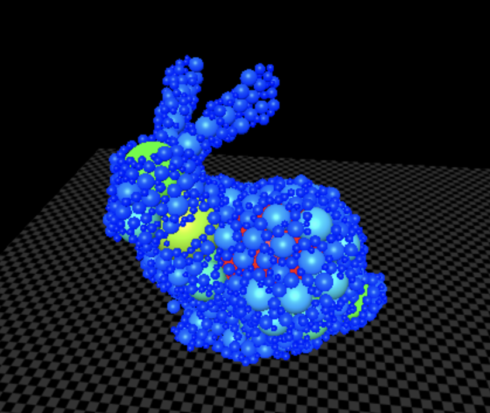

<a class="p8-src" href="https://github.com/DimitriChrysafis/SpherePacking">source</a><a href="../media/post8/bunny.html">bunny</a><a href="../media/post8/dragon.html">dragon</a><a href="../media/post8/ogre.html">ogre</a><a href="../media/post8/animation.html">binary search</a>

<iframe src="../media/post8/bunny.html" title="Sphere packing inside the Stanford Bunny" scrolling="no"></iframe>

<b>mesh</b>watertight triangles

→

<b>inside test</b>ray parity

→

<b>seed sphere</b>max grid clearance

→

<b>tangent expansion</b>bisect r, loop

→

<b>packing</b>non-overlapping spheres

GPU kernels batch the ray, distance, and overlap tests at every stage.

<h2 class="p8-h"><em>01</em>inside or outside</h2>

Cast a ray from the point and count triangle hits. Odd means inside.

<svg viewBox="0 0 760 290" role="img" aria-label="Ray parity: a point inside crosses the boundary three times, a point in the notch crosses twice"><defs><marker id="rp-ab" viewBox="0 0 10 10" refX="9" refY="5" markerWidth="7" markerHeight="7" orient="auto-start-reverse"><path d="M0,1 L10,5 L0,9 z" fill="#1d4ed8"/></marker><marker id="rp-ak" viewBox="0 0 10 10" refX="9" refY="5" markerWidth="7" markerHeight="7" orient="auto-start-reverse"><path d="M0,1 L10,5 L0,9 z" fill="#111"/></marker></defs><polygon points="60,60 250,45 310,200 370,45 540,60 560,170 500,240 300,250 90,235 40,150" fill="#f7f7f5" stroke="#111" stroke-width="2" stroke-linejoin="round"/><circle cx="60" cy="60" r="3" fill="#111"/><circle cx="250" cy="45" r="3" fill="#111"/><circle cx="310" cy="200" r="3" fill="#111"/><circle cx="370" cy="45" r="3" fill="#111"/><circle cx="540" cy="60" r="3" fill="#111"/><circle cx="560" cy="170" r="3" fill="#111"/><circle cx="500" cy="240" r="3" fill="#111"/><circle cx="300" cy="250" r="3" fill="#111"/><circle cx="90" cy="235" r="3" fill="#111"/><circle cx="40" cy="150" r="3" fill="#111"/><text x="70" y="275" font-family="'IBM Plex Mono',monospace" font-size="12" fill="#555">mesh boundary (triangle edges in 2D)</text><line x1="110" y1="150" x2="600" y2="150" stroke="#1d4ed8" stroke-width="2" marker-end="url(#rp-ab)"/><circle cx="290.6" cy="150" r="6" fill="#fff" stroke="#1d4ed8" stroke-width="2"/><text x="276.6" y="167" text-anchor="middle" font-family="'IBM Plex Mono',monospace" font-size="12" font-weight="600" fill="#1d4ed8">1</text><circle cx="329.4" cy="150" r="6" fill="#fff" stroke="#1d4ed8" stroke-width="2"/><text x="343.4" y="167" text-anchor="middle" font-family="'IBM Plex Mono',monospace" font-size="12" font-weight="600" fill="#1d4ed8">2</text><circle cx="556.4" cy="150" r="6" fill="#fff" stroke="#1d4ed8" stroke-width="2"/><text x="569.4" y="145" text-anchor="middle" font-family="'IBM Plex Mono',monospace" font-size="12" font-weight="600" fill="#1d4ed8">3</text><circle cx="110" cy="150" r="6" fill="#15803d"/><text x="106" y="174" text-anchor="middle" font-family="'Times New Roman',Times,serif" font-style="italic" font-size="20" fill="#15803d">P</text><text x="616" y="147" font-family="'IBM Plex Mono',monospace" font-size="13" font-weight="600" fill="#15803d">3 hits, odd</text><text x="616" y="165" font-family="'IBM Plex Mono',monospace" font-size="13" fill="#15803d">P inside</text><line x1="310" y1="95" x2="600" y2="95" stroke="#1d4ed8" stroke-width="2" marker-end="url(#rp-ab)"/><circle cx="350.6" cy="95" r="6" fill="#fff" stroke="#1d4ed8" stroke-width="2"/><text x="337.6" y="90" text-anchor="middle" font-family="'IBM Plex Mono',monospace" font-size="12" font-weight="600" fill="#1d4ed8">1</text><circle cx="546.4" cy="95" r="6" fill="#fff" stroke="#1d4ed8" stroke-width="2"/><text x="559.4" y="90" text-anchor="middle" font-family="'IBM Plex Mono',monospace" font-size="12" font-weight="600" fill="#1d4ed8">2</text><circle cx="310" cy="95" r="6" fill="#b91c1c"/><text x="306" y="119" text-anchor="middle" font-family="'Times New Roman',Times,serif" font-style="italic" font-size="20" fill="#b91c1c">Q</text><text x="616" y="92" font-family="'IBM Plex Mono',monospace" font-size="13" font-weight="600" fill="#b91c1c">2 hits, even</text><text x="616" y="110" font-family="'IBM Plex Mono',monospace" font-size="13" fill="#b91c1c">Q outside</text></svg>

\(E_1=V_1-V_0\)\(E_2=V_2-V_0\)\(q=\hat D\times E_2\)\(\Delta=E_1\cdot q\)\(T=O-V_0\)

hit when\(t&gt;0\)\(u\ge0\)\(v\ge0\)\(u+v\le1\)

<h2 class="p8-h"><em>02</em>seed sphere</h2>

Sample the interior on a grid and keep the point farthest from the surface. Its clearance caps every later radius.

<svg viewBox="0 0 760 310" role="img" aria-label="Grid samples inside a shape, the sample with the largest clearance and its circle touching the boundary"><defs><marker id="gc-ab" viewBox="0 0 10 10" refX="9" refY="5" markerWidth="7" markerHeight="7" orient="auto-start-reverse"><path d="M0,1 L10,5 L0,9 z" fill="#1d4ed8"/></marker><marker id="gc-ak" viewBox="0 0 10 10" refX="9" refY="5" markerWidth="7" markerHeight="7" orient="auto-start-reverse"><path d="M0,1 L10,5 L0,9 z" fill="#111"/></marker></defs><polygon points="700.6,150 697.4,158.5 691.7,166.9 683.8,174.9 674.5,182.5 664,189.9 652.8,196.8 641,203.5 628.6,209.9 615.5,215.9 601.7,221.6 586.7,226.8 570.6,231.3 553.2,235.1 534.7,237.9 515.2,239.7 495.2,240.4 475.1,240.1 455.3,238.9 436.5,237 418.8,234.7 402.4,232.4 387.4,230.3 373.4,228.9 360,228.3 346.6,228.7 332.7,230.2 317.4,232.6 300.5,235.8 281.5,239.3 260.5,242.8 237.5,245.9 213.1,248.3 188,249.4 162.8,249.2 138.6,247.5 116,244.2 95.7,239.5 78.2,233.5 63.8,226.4 52.5,218.6 44,210.2 38,201.5 34.2,192.7 32,183.9 31.2,175.3 31.5,166.7 32.8,158.3 35.2,150 38.8,141.9 44,133.9 51.1,126.3 60.2,119 71.4,112.2 84.7,106 99.8,100.4 116.4,95.7 133.9,91.6 151.7,88.3 169.2,85.4 186,82.8 201.8,80.3 216.3,77.7 229.7,74.7 242.2,71.2 254.2,67.2 266.3,62.6 278.9,57.7 292.5,52.7 307.4,47.8 323.7,43.4 341.3,39.8 360,37.3 379.3,36.1 398.8,36.2 417.9,37.6 436.1,40.3 453.2,43.9 469.1,48.3 483.7,53.1 497.4,58.1 510.6,63 523.7,67.6 537.2,71.9 551.6,76 567.1,79.9 583.6,83.7 601,87.8 618.9,92.3 636.6,97.3 653.3,103.1 668.5,109.6 681.2,116.8 691.1,124.6 697.6,132.8 700.8,141.4" fill="#f7f7f5" stroke="#111" stroke-width="2" stroke-linejoin="round"/><circle cx="56" cy="144" r="1.6" fill="#9a9a9a"/><circle cx="56" cy="170" r="1.9" fill="#9a9a9a"/><circle cx="56" cy="196" r="1.7" fill="#9a9a9a"/><circle cx="82" cy="118" r="1.5" fill="#9a9a9a"/><circle cx="82" cy="144" r="2.1" fill="#9a9a9a"/><circle cx="82" cy="170" r="2.6" fill="#9a9a9a"/><circle cx="82" cy="196" r="2.2" fill="#9a9a9a"/><circle cx="82" cy="222" r="1.5" fill="#9a9a9a"/><circle cx="108" cy="118" r="1.7" fill="#9a9a9a"/><circle cx="108" cy="144" r="2.4" fill="#9a9a9a"/><circle cx="108" cy="170" r="3.1" fill="#9a9a9a"/><circle cx="108" cy="196" r="2.5" fill="#9a9a9a"/><circle cx="108" cy="222" r="1.8" fill="#9a9a9a"/><circle cx="134" cy="118" r="1.9" fill="#9a9a9a"/><circle cx="134" cy="144" r="2.6" fill="#9a9a9a"/><circle cx="134" cy="170" r="3.3" fill="#9a9a9a"/><circle cx="134" cy="196" r="2.6" fill="#9a9a9a"/><circle cx="134" cy="222" r="1.9" fill="#9a9a9a"/><circle cx="160" cy="118" r="2.1" fill="#9a9a9a"/><circle cx="160" cy="144" r="2.8" fill="#9a9a9a"/><circle cx="160" cy="170" r="3.4" fill="#9a9a9a"/><circle cx="160" cy="196" r="2.7" fill="#9a9a9a"/><circle cx="160" cy="222" r="2" fill="#9a9a9a"/><circle cx="186" cy="92" r="1.5" fill="#9a9a9a"/><circle cx="186" cy="118" r="2.2" fill="#9a9a9a"/><circle cx="186" cy="144" r="2.9" fill="#9a9a9a"/><circle cx="186" cy="170" r="3.4" fill="#9a9a9a"/><circle cx="186" cy="196" r="2.7" fill="#9a9a9a"/><circle cx="186" cy="222" r="2" fill="#9a9a9a"/><circle cx="212" cy="92" r="1.6" fill="#9a9a9a"/><circle cx="212" cy="118" r="2.3" fill="#9a9a9a"/><circle cx="212" cy="144" r="3" fill="#9a9a9a"/><circle cx="212" cy="170" r="3.4" fill="#9a9a9a"/><circle cx="212" cy="196" r="2.7" fill="#9a9a9a"/><circle cx="212" cy="222" r="1.9" fill="#9a9a9a"/><circle cx="238" cy="92" r="1.7" fill="#9a9a9a"/><circle cx="238" cy="118" r="2.4" fill="#9a9a9a"/><circle cx="238" cy="144" r="3.1" fill="#9a9a9a"/><circle cx="238" cy="170" r="3.3" fill="#9a9a9a"/><circle cx="238" cy="196" r="2.6" fill="#9a9a9a"/><circle cx="238" cy="222" r="1.9" fill="#9a9a9a"/><circle cx="264" cy="92" r="1.9" fill="#9a9a9a"/><circle cx="264" cy="118" r="2.6" fill="#9a9a9a"/><circle cx="264" cy="144" r="3.3" fill="#9a9a9a"/><circle cx="264" cy="170" r="3.2" fill="#9a9a9a"/><circle cx="264" cy="196" r="2.5" fill="#9a9a9a"/><circle cx="264" cy="222" r="1.8" fill="#9a9a9a"/><circle cx="290" cy="66" r="1.5" fill="#9a9a9a"/><circle cx="290" cy="92" r="2.2" fill="#9a9a9a"/><circle cx="290" cy="118" r="2.9" fill="#9a9a9a"/><circle cx="290" cy="144" r="3.6" fill="#9a9a9a"/><circle cx="290" cy="170" r="3.1" fill="#9a9a9a"/><circle cx="290" cy="196" r="2.3" fill="#9a9a9a"/><circle cx="290" cy="222" r="1.6" fill="#9a9a9a"/><circle cx="316" cy="66" r="1.8" fill="#9a9a9a"/><circle cx="316" cy="92" r="2.4" fill="#9a9a9a"/><circle cx="316" cy="118" r="3.1" fill="#9a9a9a"/><circle cx="316" cy="144" r="3.6" fill="#9a9a9a"/><circle cx="316" cy="170" r="2.9" fill="#9a9a9a"/><circle cx="316" cy="196" r="2.2" fill="#9a9a9a"/><circle cx="316" cy="222" r="1.5" fill="#9a9a9a"/><circle cx="342" cy="66" r="1.9" fill="#9a9a9a"/><circle cx="342" cy="92" r="2.6" fill="#9a9a9a"/><circle cx="342" cy="118" r="3.3" fill="#9a9a9a"/><circle cx="342" cy="144" r="3.6" fill="#9a9a9a"/><circle cx="342" cy="170" r="2.8" fill="#9a9a9a"/><circle cx="342" cy="196" r="2.1" fill="#9a9a9a"/><circle cx="342" cy="222" r="1.4" fill="#9a9a9a"/><circle cx="368" cy="66" r="2" fill="#9a9a9a"/><circle cx="368" cy="92" r="2.7" fill="#9a9a9a"/><circle cx="368" cy="118" r="3.5" fill="#9a9a9a"/><circle cx="368" cy="144" r="3.6" fill="#9a9a9a"/><circle cx="368" cy="170" r="2.8" fill="#9a9a9a"/><circle cx="368" cy="196" r="2.1" fill="#9a9a9a"/><circle cx="394" cy="66" r="2" fill="#9a9a9a"/><circle cx="394" cy="92" r="2.8" fill="#9a9a9a"/><circle cx="394" cy="118" r="3.5" fill="#9a9a9a"/><circle cx="394" cy="144" r="3.6" fill="#9a9a9a"/><circle cx="394" cy="170" r="2.9" fill="#9a9a9a"/><circle cx="394" cy="196" r="2.2" fill="#9a9a9a"/><circle cx="394" cy="222" r="1.5" fill="#9a9a9a"/><circle cx="420" cy="66" r="2" fill="#9a9a9a"/><circle cx="420" cy="92" r="2.7" fill="#9a9a9a"/><circle cx="420" cy="118" r="3.4" fill="#9a9a9a"/><circle cx="420" cy="144" r="3.7" fill="#9a9a9a"/><circle cx="420" cy="170" r="3" fill="#9a9a9a"/><circle cx="420" cy="196" r="2.3" fill="#9a9a9a"/><circle cx="420" cy="222" r="1.6" fill="#9a9a9a"/><circle cx="446" cy="66" r="1.8" fill="#9a9a9a"/><circle cx="446" cy="92" r="2.5" fill="#9a9a9a"/><circle cx="446" cy="118" r="3.2" fill="#9a9a9a"/><circle cx="446" cy="170" r="3.1" fill="#9a9a9a"/><circle cx="446" cy="196" r="2.4" fill="#9a9a9a"/><circle cx="446" cy="222" r="1.6" fill="#9a9a9a"/><circle cx="472" cy="66" r="1.6" fill="#9a9a9a"/><circle cx="472" cy="92" r="2.3" fill="#9a9a9a"/><circle cx="472" cy="118" r="3" fill="#9a9a9a"/><circle cx="472" cy="144" r="3.7" fill="#9a9a9a"/><circle cx="472" cy="170" r="3.1" fill="#9a9a9a"/><circle cx="472" cy="196" r="2.4" fill="#9a9a9a"/><circle cx="472" cy="222" r="1.7" fill="#9a9a9a"/><circle cx="498" cy="66" r="1.4" fill="#9a9a9a"/><circle cx="498" cy="92" r="2.1" fill="#9a9a9a"/><circle cx="498" cy="118" r="2.8" fill="#9a9a9a"/><circle cx="498" cy="144" r="3.4" fill="#9a9a9a"/><circle cx="498" cy="170" r="3.2" fill="#9a9a9a"/><circle cx="498" cy="196" r="2.4" fill="#9a9a9a"/><circle cx="498" cy="222" r="1.7" fill="#9a9a9a"/><circle cx="524" cy="92" r="1.8" fill="#9a9a9a"/><circle cx="524" cy="118" r="2.5" fill="#9a9a9a"/><circle cx="524" cy="144" r="3.2" fill="#9a9a9a"/><circle cx="524" cy="170" r="3.1" fill="#9a9a9a"/><circle cx="524" cy="196" r="2.4" fill="#9a9a9a"/><circle cx="524" cy="222" r="1.7" fill="#9a9a9a"/><circle cx="550" cy="92" r="1.6" fill="#9a9a9a"/><circle cx="550" cy="118" r="2.3" fill="#9a9a9a"/><circle cx="550" cy="144" r="3" fill="#9a9a9a"/><circle cx="550" cy="170" r="3" fill="#9a9a9a"/><circle cx="550" cy="196" r="2.3" fill="#9a9a9a"/><circle cx="550" cy="222" r="1.6" fill="#9a9a9a"/><circle cx="576" cy="92" r="1.5" fill="#9a9a9a"/><circle cx="576" cy="118" r="2.2" fill="#9a9a9a"/><circle cx="576" cy="144" r="2.9" fill="#9a9a9a"/><circle cx="576" cy="170" r="2.8" fill="#9a9a9a"/><circle cx="576" cy="196" r="2.1" fill="#9a9a9a"/><circle cx="576" cy="222" r="1.4" fill="#9a9a9a"/><circle cx="602" cy="118" r="2" fill="#9a9a9a"/><circle cx="602" cy="144" r="2.7" fill="#9a9a9a"/><circle cx="602" cy="170" r="2.5" fill="#9a9a9a"/><circle cx="602" cy="196" r="1.9" fill="#9a9a9a"/><circle cx="628" cy="118" r="1.8" fill="#9a9a9a"/><circle cx="628" cy="144" r="2.5" fill="#9a9a9a"/><circle cx="628" cy="170" r="2.2" fill="#9a9a9a"/><circle cx="628" cy="196" r="1.6" fill="#9a9a9a"/><circle cx="654" cy="118" r="1.6" fill="#9a9a9a"/><circle cx="654" cy="144" r="2.2" fill="#9a9a9a"/><circle cx="654" cy="170" r="1.8" fill="#9a9a9a"/><circle cx="680" cy="144" r="1.8" fill="#9a9a9a"/><circle cx="446" cy="144" r="93.4" fill="none" stroke="#1d4ed8" stroke-width="2"/><line x1="446" y1="144" x2="434" y2="236.7" stroke="#111" stroke-width="2" marker-end="url(#gc-ak)"/><circle cx="434" cy="236.7" r="4" fill="#fff" stroke="#111" stroke-width="2"/><circle cx="446" cy="144" r="5" fill="#1d4ed8"/><text x="434" y="134" text-anchor="end" font-family="'Times New Roman',Times,serif" font-style="italic" font-size="20" fill="#1d4ed8" paint-order="stroke" stroke="#f7f7f5" stroke-width="5" stroke-linejoin="round">p*</text><text x="460" y="194.3" font-family="'Times New Roman',Times,serif" font-style="italic" font-size="18" fill="#111" paint-order="stroke" stroke="#f7f7f5" stroke-width="5" stroke-linejoin="round">R<tspan font-size="13" dy="4">max</tspan></text><text x="742" y="300" text-anchor="end" font-family="'IBM Plex Mono',monospace" font-size="12" fill="#555">dot size = distance to boundary</text></svg>

<h2 class="p8-h"><em>03</em>tangent expansion</h2>

Grow a new sphere along a direction from an accepted one. It stays tangent to its anchor until the surface or a neighbor stops it.

<svg viewBox="0 0 760 340" role="img" aria-label="Tangent expansion: a candidate sphere grows along a direction from an anchor sphere until it touches the boundary"><defs><marker id="te-ab" viewBox="0 0 10 10" refX="9" refY="5" markerWidth="7" markerHeight="7" orient="auto-start-reverse"><path d="M0,1 L10,5 L0,9 z" fill="#1d4ed8"/></marker><marker id="te-ak" viewBox="0 0 10 10" refX="9" refY="5" markerWidth="7" markerHeight="7" orient="auto-start-reverse"><path d="M0,1 L10,5 L0,9 z" fill="#111"/></marker></defs><polygon points="0,0 760,0 760,80 0,30" fill="#f7f7f5"/><line x1="0" y1="30" x2="760" y2="80" stroke="#111" stroke-width="2"/><text x="16" y="21" font-family="'Times New Roman',Times,serif" font-style="italic" font-size="18" fill="#111">∂Ω</text><circle cx="575" cy="220" r="72" fill="#f7f7f5" stroke="#111" stroke-width="1.5"/><text x="575" y="222" text-anchor="middle" font-family="'Times New Roman',Times,serif" font-style="italic" font-size="19" fill="#111">C<tspan font-size="13" dy="4">i</tspan></text><text x="575" y="244" text-anchor="middle" font-family="'IBM Plex Mono',monospace" font-size="11" fill="#555">accepted</text><circle cx="190" cy="235" r="85" fill="#f7f7f5" stroke="#111" stroke-width="2"/><circle cx="372.4" cy="143.8" r="118.9" fill="none" stroke="#b91c1c" stroke-width="1.5" stroke-dasharray="6 5"/><circle cx="354.7" cy="152.7" r="99.1" fill="none" stroke="#1d4ed8" stroke-width="2.5"/><line x1="190" y1="235" x2="354.7" y2="152.7" stroke="#111" stroke-width="1.5"/><line x1="212.4" y1="261.8" x2="264.2" y2="235.9" stroke="#1d4ed8" stroke-width="2.5" marker-end="url(#te-ab)"/><text x="246.3" y="271" text-anchor="middle" font-family="'Times New Roman',Times,serif" font-style="italic" font-size="20" font-weight="bold" fill="#1d4ed8">d̂</text><circle cx="190" cy="235" r="4" fill="#111"/><circle cx="354.7" cy="152.7" r="4" fill="#1d4ed8"/><circle cx="266" cy="197" r="4" fill="#fff" stroke="#111" stroke-width="2"/><text x="176" y="259" text-anchor="middle" font-family="'Times New Roman',Times,serif" font-style="italic" font-size="19" fill="#111">C<tspan font-size="13" dy="4">a</tspan></text><text x="364.7" y="178.7" text-anchor="middle" font-family="'Times New Roman',Times,serif" font-style="italic" font-size="19" fill="#1d4ed8">C</text><text x="220.9" y="201.7" text-anchor="middle" font-family="'Times New Roman',Times,serif" font-style="italic" font-size="18" fill="#111">r<tspan font-size="13" dy="4">a</tspan></text><text x="303.2" y="160.5" text-anchor="middle" font-family="'Times New Roman',Times,serif" font-style="italic" font-size="18" fill="#1d4ed8">r</text><circle cx="361.2" cy="53.8" r="4.5" fill="#fff" stroke="#1d4ed8" stroke-width="2"/><line x1="330" y1="312" x2="362" y2="312" stroke="#1d4ed8" stroke-width="2.5"/><text x="372" y="316" font-family="'IBM Plex Mono',monospace" font-size="12" fill="#1d4ed8">valid: touches ∂Ω</text><line x1="330" y1="332" x2="362" y2="332" stroke="#b91c1c" stroke-width="1.5" stroke-dasharray="6 5"/><text x="372" y="336" font-family="'IBM Plex Mono',monospace" font-size="12" fill="#b91c1c">too big: crosses ∂Ω</text></svg>

<h2 class="p8-h"><em>04</em>radius by bisection</h2>

Keep L valid and H invalid, test the midpoint, and stop when the bracket is tight.

<svg viewBox="0 0 760 250" role="img" aria-label="Binary search on the radius: valid lower bound L and invalid upper bound H close in on r star"><line x1="396" y1="16" x2="396" y2="216" stroke="#111" stroke-width="1.5" stroke-dasharray="4 4"/><line x1="90" y1="216" x2="600" y2="216" stroke="#111" stroke-width="2"/><line x1="90" y1="211" x2="90" y2="221" stroke="#111" stroke-width="2"/><line x1="600" y1="211" x2="600" y2="221" stroke="#111" stroke-width="2"/><text x="90" y="240" text-anchor="middle" font-family="'Times New Roman',Times,serif" font-style="italic" font-size="17" fill="#111">0</text><text x="600" y="240" text-anchor="middle" font-family="'Times New Roman',Times,serif" font-style="italic" font-size="17" fill="#111">R<tspan font-size="12" dy="4">max</tspan></text><text x="396" y="240" text-anchor="middle" font-family="'Times New Roman',Times,serif" font-style="italic" font-size="17" fill="#111">r*</text><text x="20" y="38" font-family="'IBM Plex Mono',monospace" font-size="12" fill="#555">k=0</text><line x1="90" y1="34" x2="600" y2="34" stroke="#d8d8d8" stroke-width="2"/><line x1="90" y1="34" x2="600" y2="34" stroke="#111" stroke-width="3"/><circle cx="90" cy="34" r="6" fill="#15803d"/><circle cx="600" cy="34" r="6" fill="#b91c1c"/><text x="90" y="23" text-anchor="middle" font-family="'Times New Roman',Times,serif" font-style="italic" font-size="16" fill="#15803d">L</text><text x="600" y="23" text-anchor="middle" font-family="'Times New Roman',Times,serif" font-style="italic" font-size="16" fill="#b91c1c">H</text><line x1="345" y1="26" x2="345" y2="42" stroke="#1d4ed8" stroke-width="2.5"/><text x="625" y="38" font-family="'IBM Plex Mono',monospace" font-size="12" fill="#15803d">m valid, L ← m</text><text x="20" y="76" font-family="'IBM Plex Mono',monospace" font-size="12" fill="#555">k=1</text><line x1="90" y1="72" x2="600" y2="72" stroke="#d8d8d8" stroke-width="2"/><line x1="345" y1="72" x2="600" y2="72" stroke="#111" stroke-width="3"/><circle cx="345" cy="72" r="6" fill="#15803d"/><circle cx="600" cy="72" r="6" fill="#b91c1c"/><line x1="472.5" y1="64" x2="472.5" y2="80" stroke="#1d4ed8" stroke-width="2.5"/><text x="625" y="76" font-family="'IBM Plex Mono',monospace" font-size="12" fill="#b91c1c">m invalid, H ← m</text><text x="20" y="114" font-family="'IBM Plex Mono',monospace" font-size="12" fill="#555">k=2</text><line x1="90" y1="110" x2="600" y2="110" stroke="#d8d8d8" stroke-width="2"/><line x1="345" y1="110" x2="472.5" y2="110" stroke="#111" stroke-width="3"/><circle cx="345" cy="110" r="6" fill="#15803d"/><circle cx="472.5" cy="110" r="6" fill="#b91c1c"/><line x1="408.8" y1="102" x2="408.8" y2="118" stroke="#1d4ed8" stroke-width="2.5"/><text x="625" y="114" font-family="'IBM Plex Mono',monospace" font-size="12" fill="#b91c1c">m invalid, H ← m</text><text x="20" y="152" font-family="'IBM Plex Mono',monospace" font-size="12" fill="#555">k=3</text><line x1="90" y1="148" x2="600" y2="148" stroke="#d8d8d8" stroke-width="2"/><line x1="345" y1="148" x2="408.8" y2="148" stroke="#111" stroke-width="3"/><circle cx="345" cy="148" r="6" fill="#15803d"/><circle cx="408.8" cy="148" r="6" fill="#b91c1c"/><line x1="376.9" y1="140" x2="376.9" y2="156" stroke="#1d4ed8" stroke-width="2.5"/><text x="625" y="152" font-family="'IBM Plex Mono',monospace" font-size="12" fill="#15803d">m valid, L ← m</text><text x="20" y="190" font-family="'IBM Plex Mono',monospace" font-size="12" fill="#555">k=4</text><line x1="90" y1="186" x2="600" y2="186" stroke="#d8d8d8" stroke-width="2"/><line x1="376.9" y1="186" x2="408.8" y2="186" stroke="#111" stroke-width="3"/><circle cx="376.9" cy="186" r="6" fill="#15803d"/><circle cx="408.8" cy="186" r="6" fill="#b91c1c"/><text x="625" y="190" font-family="'IBM Plex Mono',monospace" font-size="12" fill="#111">accept r = L</text></svg>

<h2 class="p8-h"><em>05</em>result</h2>

Large seeds first, then smaller spheres fill the gaps.

